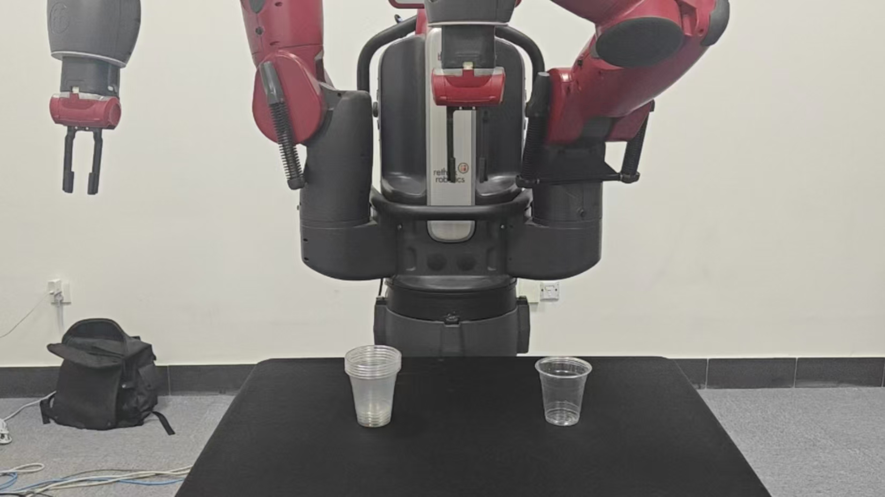

# Stackcup Model



## 1. Project Overview

This project aims to enable robotic grasping of transparent objects using a single RGB image. The system integrates the following key technologies:

- Segment Anything 2 (SAM2): object segmentation and mask generation
- Depth Anything V2 (DAM): monocular depth estimation
- Diffusion Policy (DP): action-sequence prediction and control

The overall workflow is as follows:

1. Use the Baxter robot to collect RGB images and joint-state data;
2. Apply YOLOv8, SAM, and DAM to preprocess the collected data in batches;
3. Generate depth priors for transparent objects and convert the data into zarr format;
4. Configure the Diffusion Policy training parameters and train the grasping model;
5. Perform real-time inference on the Baxter platform and execute grasping tasks.


## 2. Pipeline Description

Our work explores a pipeline that leverages Segment Anything 2 and Depth-Anything-V2 to obtain a depth prior for transparent objects from a single RGB image, and then uses a Diffusion-Policy model to complete robotic grasping experiments. The physical experiments are conducted on the Baxter platform, which is used for both data collection and real-time inference.

### 2.1 Data Collection and Preprocessing

- Baxter is used to collect RGB images and joint pose data;
- YOLOv8, SAM, and DAM are used for batch preprocessing;
- RGB images are converted into mask-depth maps and packed into zarr format.

### 2.2 Model Training

- Configure the Diffusion Policy training parameters to match the current task data flow;
- Train the grasping policy model using the processed dataset.

### 2.3 Inference Execution

- Use a dual-thread mechanism for continuous inference;
- The acquisition side collects Baxter RGB images and pose information in real time;
- The inference side preprocesses the data and outputs candidate action sequences for robot execution.


## 3. Configuration and Execution

### 3.1 Create and Activate a Python Environment

This project has been validated with Python 3.9. The commands are as follows:

```bash
conda create -n dp python=3.9
```

If a suitable environment already exists, it can be reused directly.

### 3.2 Install Diffusion Policy

Run the following in the project root directory:

```bash
cd ./
pip install -r requirements.txt
pip install .
cd -
```

Note: Some dependency libraries may fail to install because their source packages are unavailable. These dependencies are stored in `deps/` and can be installed manually.

### 3.3 Install Depth-Anything-V2

```bash
cd ./Depth-Anything-V2
pip install -r requirements.txt
pip install .
cd -
```

### 3.4 Install SAM2

```bash
cd ./sam2-main
pip install .
cd -
```

### 3.5 Configure the Baxter Environment

```bash
cd ./ws_baxter
catkin_make
catkin_make install
cd -
```

Notes:

- Before compiling Baxter-related packages, ensure that ROS 1 is installed on the system;
- If the build fails, it may be because the current mainstream ROS 1 version no longer supports older MoveIt packages, leading to missing legacy ROS dependencies;
- If MoveIt is not strictly required, the `moveit_robots` package can be removed and the build can proceed normally.

After compilation, configure `baxter.sh` and replace `your_ip` with the IP address of the current machine to ensure that Baxter connects correctly.

After installation, to use the Baxter package in the Conda environment, launch the Baxter environment first and then activate the Conda environment:

```bash
. baxter.sh
conda activate [your env]
```


## 4. Data Collection

There are three Baxter-based data collection schemes:

- `keyboard_sampler_step.py`: keyboard step-by-step collection
- `xbox_sampler_step.py`: Xbox controller key-based step collection
- `xbox_sampler_continue.py`: Xbox joystick continuous servo collection

Start the collection process with:

```bash
python xbox_sampler_continue.py
```


## 5. Data Preprocessing

The collected RGB images are processed in batches to generate mask-depth maps using SAM and DAM:

```bash
python depth_boxSD.py
```

Then package the dataset into zarr format:

```bash
python data2zarr.py
```


## 6. Diffusion Policy Training

Configure the training parameters by editing `stackcup_cnn_xbox.yaml`.

Start training with:

```bash
python train.py --config-dir=. --config-name=stackcup_cnn_xbox.yaml training.device=cuda:0 hydra.run.dir='outputs/${now:%Y.%m.%d}/${now:%H.%M.%S}'
```

This command sets the training device to CUDA and saves the outputs under `outputs/`, creating a timestamped result folder.


## 7. Baxter Real-World Inference

Configure the inference parameters by editing `stackcup_maskdepth.yaml`.

The Baxter real-world inference supports three execution modes:

- `forward_step.py`: step-by-step execution
- `forward_continue.py`: continuous servo execution

Example execution:

```bash
cd ./ws_baxter
. baxter.sh
cd -
python forward_step.py
```


## 8. Code Structure

```text
Stackcup_Model/
├── checkpoints/                   # Model checkpoints
├── data/                          # Collected datasets
├── deps/                          # Additional third-party dependencies
├── outputs/                       # Diffusion Policy training outputs
├── Depth-Anything-V2/             # Depth Anything V2 model code
├── sam2-main/                     # SAM2 model code
├── diffusion_policy/              # Diffusion Policy source code
├── ws_baxter/                     # Baxter ROS workspace
├── dp_space/                      # Inference/training configs and key DP files
├── model/                         # Core Stackcup model code
│   ├── datasetmanager/            # Dataset management; processes RGB files with SAM and DAM
│   ├── baxter/                   # Baxter motion classes and interface integration
│   ├── runner/                   # Inference logic for real-world execution, including grasping and placement
│   └── sampler/                  # Sampling utilities for Baxter
├── scripts/                       # Runtime scripts
│   ├── forward/                  # Baxter real-world inference scripts
│   ├── process/                  # Batch preprocessing with SAM/DAM and zarr packaging
│   ├── sampler/                  # Baxter sampling scripts
│   └── train/                    # Diffusion Policy training scripts
├── README.md                     # Original project documentation
├── train.py                      # Training entry script
├── depth_boxSD.py                # RGB depth preprocessing script
├── data2zarr.py                  # Dataset packaging script
├── forward_step.py               # Step-by-step inference script
├── forward_continue.py           # Continuous inference script
├── keyboard_sampler_step.py      # Keyboard sampling script
├── xbox_sampler_step.py          # Controller step sampling script
├── xbox_sampler_continue.py      # Controller continuous sampling script
├── stackcup_cnn_xbox.yaml        # Training config file
├── stackcup_mask_transformer.yaml # Training config file
├── stackcup_mask.yaml            # Training config file
├── stackcup_maskdepth.yaml       # Inference config file
└── ...
```


## 9. Related Projects

- Diffusion Policy: https://github.com/real-stanford/diffusion_policy.git
- Depth Anything V2: https://github.com/DepthAnything/Depth-Anything-V2.git
- Segment Anything 2: https://github.com/facebookresearch/sam2.git